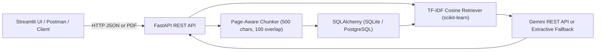

# DocuQuery — Page-Cited RAG REST API & Web App

[](https://github.com/Snehatyagi2/docuquery/actions/workflows/ci.yml)

**DocuQuery** is a production-ready **Retrieval-Augmented Generation (RAG)** REST API and web application that indexes multi-page PDFs and text documents, retrieves relevant passages using TF-IDF cosine similarity, and returns **page-cited answers** with relevance scores and query latency.

---

## Live Deployment

| Component | URL |
| :--- | :--- |
| **Live Web App (AWS EC2 + Docker + k3s)** | http://16.179.104.253/ |
| **AWS Swagger Docs** | http://16.179.104.253/docs |
| **Render Web App (Backup)** | https://docuquery-api-vs52.onrender.com/ |
| **Render Swagger Docs** | https://docuquery-api-vs52.onrender.com/docs |

> **Note:** The backend runs on Render's free tier and sleeps after 15 minutes of inactivity; the first request after an idle period may take ~30–50 seconds to wake up.

---

## Why DocuQuery?

Standard LLM chat interfaces often hallucinate or omit where an answer came from. In **audit, compliance, financial risk, and consulting workflows**, every claim must be traceable. DocuQuery solves this by:
1. Preserving **1-based page numbers** across overlapping text chunks.
2. Returning **verifiable passage snippets + similarity scores** with every answer.
3. Providing a built-in **evaluation endpoint (`POST /api/v1/evaluate`)** to measure **Hit Rate@K**, **Mean Reciprocal Rank (MRR)**, and **latency** on labeled test sets.

---

## System Architecture



For a deeper technical breakdown (chunking parameters, retrieval scoring, and evaluation metrics), see [docs/ARCHITECTURE.md](docs/ARCHITECTURE.md).

---

## API Reference

| Method | Endpoint | Description |
| :--- | :--- | :--- |
| `GET` | `/health` | Service health and version check |
| `POST` | `/api/v1/documents` | Ingest raw text or structured multi-page JSON |
| `POST` | `/api/v1/documents/upload` | Upload and extract text per page from a `.pdf` file |
| `GET` | `/api/v1/documents` | List all indexed documents with page & chunk counts |
| `DELETE` | `/api/v1/documents/{document_id}` | Delete a document and cascade-delete its chunks |
| `POST` | `/api/v1/query` | Query documents and return answer, latency, and page citations |
| `POST` | `/api/v1/evaluate` | Benchmark retrieval quality (`Hit Rate@K`, `MRR`, `avg_latency_ms`) |

### Example Request: `POST /api/v1/query`

```json
{
  "question": "What is the dispatch SLA target for Tier-1 cities?",
  "top_k": 3
}
```

### Example Response

```json
{
  "question": "What is the dispatch SLA target for Tier-1 cities?",
  "answer": "Based on Supply Chain SLA Report (Page 1): Warehouse dispatch SLA target is under 4 hours for Tier-1 cities.",
  "mode": "extractive",
  "latency_ms": 12.45,
  "citations": [
    {
      "document_id": "a1b2c3d4-...",
      "document_title": "Supply Chain SLA Report",
      "page_number": 1,
      "chunk_index": 0,
      "score": 0.7124,
      "snippet": "Warehouse dispatch SLA target is under 4 hours for Tier-1 cities."
    }
  ]
}
```

---

## Testing & Postman

- **Automated Test Suite (`unittest` / `pytest`):**
  ```bash
  python -m unittest discover -s tests -v
  # or
  pytest -v
  ```
- **Postman Collection:** Import [postman/DocuQuery.postman_collection.json](postman/DocuQuery.postman_collection.json) into Postman. It includes automated test assertions (`200`/`201` status checks, citation validation) and chains `{{docId}}` automatically between ingest, query, and delete requests.

---

## Local Setup

```bash
# 1. Clone and enter the repository
git clone https://github.com/Snehatyagi2/docuquery.git
cd docuquery

# 2. Install dependencies
pip install -r requirements.txt

# 3. Configure environment (optional: add GEMINI_API_KEY for LLM synthesis)
cp .env.example .env

# 4. Run the FastAPI backend
uvicorn app.main:app --reload

# 5. Run the Streamlit UI (in a second terminal)
streamlit run ui/streamlit_app.py
```

### Docker

```bash
docker build -t docuquery-api .
docker run -p 8000:8000 --env-file .env docuquery-api
```

---

## Project Structure

```text
docuquery/
├── .github/workflows/ci.yml          # GitHub Actions CI (pytest on push/PR)
├── app/
│   ├── config.py                     # Environment configuration
│   ├── database.py                   # SQLAlchemy models (documents, chunks)
│   ├── main.py                       # FastAPI routes & lifespan
│   ├── rag.py                        # Chunking, TF-IDF retrieval, Gemini/extractive synthesis
│   └── schemas.py                    # Pydantic v2 request/response schemas
├── docs/
│   └── ARCHITECTURE.md               # Technical design & evaluation methodology
├── postman/
│   └── DocuQuery.postman_collection.json
├── tests/
│   └── test_api.py                   # End-to-end API & evaluation tests
├── ui/
│   └── streamlit_app.py              # Streamlit frontend
├── Dockerfile
├── render.yaml                       # Render deployment blueprint
└── requirements.txt
```
