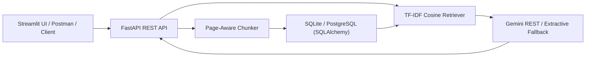

# DocuQuery — Page-Cited RAG REST API

Production-ready Retrieval-Augmented Generation (RAG) REST API built with **FastAPI**, **SQLAlchemy**, **scikit-learn (TF-IDF Cosine Retrieval)**, and optional **Gemini** answer synthesis, complete with **page-level citations**, an automated **RAG evaluation endpoint** (`Hit Rate@K`, `MRR`), a **Postman collection**, **Streamlit UI**, **Docker**, and **GitHub Actions CI**.

## Live Deployment

- **Live API:** https://docuquery-api-vs52.onrender.com
- **Interactive Swagger Docs:** https://docuquery-api-vs52.onrender.com/docs
- **Health Check:** https://docuquery-api-vs52.onrender.com/health

## Architecture



## Quickstart

```bash
# 1. Start the FastAPI server
uvicorn app.main:app --reload

# 2. Run the Streamlit UI (in a second terminal)
streamlit run ui/streamlit_app.py

# 3. Run automated tests
python -m unittest discover -s tests -v
```

- Interactive Swagger Docs: `http://127.0.0.1:8000/docs`
- Postman Collection: [postman/DocuQuery.postman_collection.json](postman/DocuQuery.postman_collection.json)
